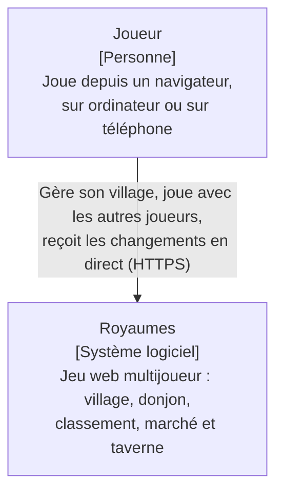
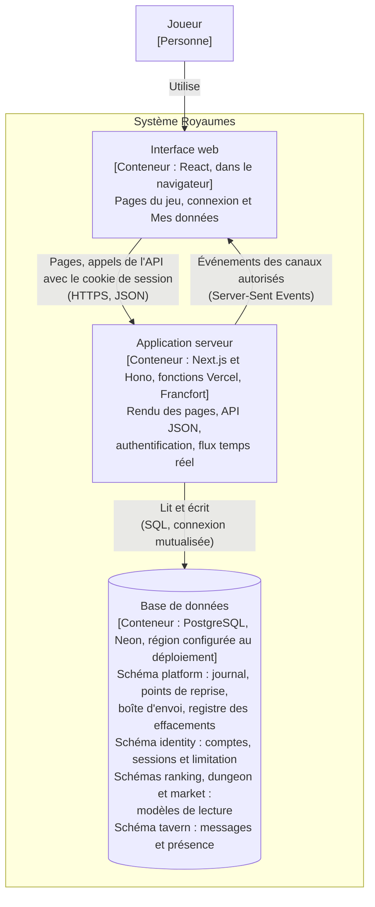
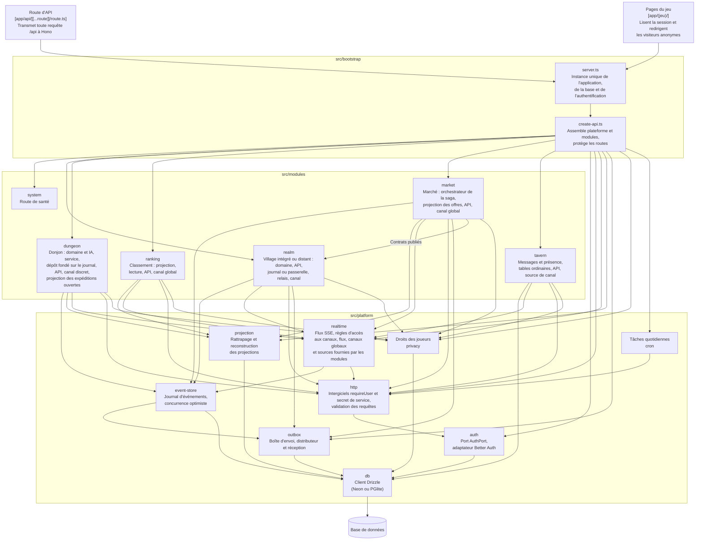
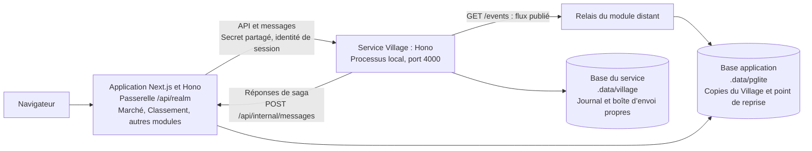
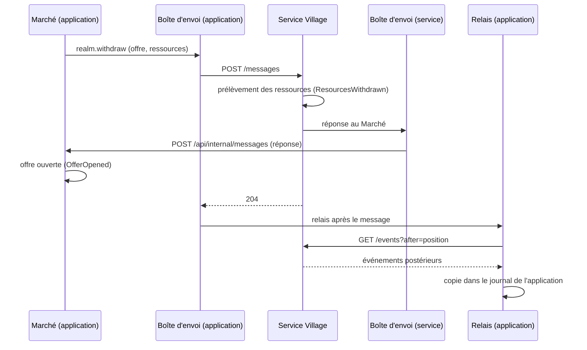
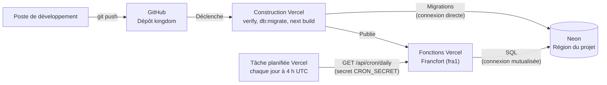

# Architecture de Royaumes

Ce document décrit la structure du système selon le modèle C4, du plus général au plus
détaillé. Les raisons des choix qui y apparaissent sont consignées dans les
[décisions d'architecture](adr/README.md).

Les diagrammes sont rédigés en Mermaid : ils sont versionnés avec le code, et mis à jour
dans le même commit que la modification qu'ils décrivent.

## Niveau 1 - Contexte

Royaumes ne dépend d'aucun système externe : il n'envoie aucun courrier électronique et
ne fait appel à aucun service de paiement ni à aucun fournisseur d'identité. Les comptes
des joueurs sont gérés par le système lui-même.

## Niveau 2 - Conteneurs

| Conteneur | Technologies | Responsabilités |
| --- | --- | --- |
| Interface web | React, composants des modules (`ui.tsx`) | Affichage des vues, envoi des actions du joueur, abonnement aux canaux temps réel |
| Application serveur | Next.js, Hono, Better Auth, Drizzle | Contrôle d'accès, règles du jeu, enregistrement des événements, diffusion des flux |
| Base de données | PostgreSQL (Neon en production, PGlite en local et en test) | Conservation du journal d'événements, des comptes, des sessions, de la boîte d'envoi et des traces d'effacement ; projections et tables de la Taverne |

Le journal d'événements est la source de vérité du Village, du Donjon et du Marché. Les tables des schémas `ranking`,
`dungeon` et `market` sont des modèles de lecture, dérivés du journal par des projections : elles peuvent
être vidées puis reconstruites à tout moment, sans perte d'information.

La boîte d'envoi conserve les demandes à distribuer et leur état de traitement. Elle ne doit
pas être vidée lors de la reconstruction d'une projection : elle contient les étapes encore
nécessaires à l'aboutissement des sagas.

L'interface web ne communique jamais directement avec la base : toute lecture et toute
écriture passent par l'application serveur, qui applique le contrôle d'accès.

La Taverne utilise ses tables comme source de vérité : elles contiennent les messages et
la dernière présence, et ne sont pas reconstruites par rejeu. Une source fournie par le
module alimente son canal SSE à partir de l'identifiant croissant des messages. Les
lectures et la tâche quotidienne appliquent la conservation ([ADR 0008](adr/0008-donnees-personnelles.md)).

## Niveau 3 - Composants de l'application serveur

Une flèche signifie « dépend de ». Le diagramme ne montre que les dépendances principales :
`server.ts` crée également lui-même la base, le journal et l'adaptateur d'authentification,
qu'il transmet à `create-api.ts`. Les modules `dungeon`, `ranking` et `market` écrivent directement
dans leurs propres tables, au sein de la transaction fournie par le moteur des projections.

Le module `ranking` lit des événements du Village et du Donjon, mais n'importe aucun de leurs
fichiers en dehors de leurs contrats : il ne dépend que de leur langage publié, c'est-à-dire
du nom et des données de leurs événements, ainsi que du préfixe de leurs flux.

Le module `market` demande les mouvements des villages par des messages dans la boîte d'envoi,
que le distributeur remet aux gestionnaires du Village. Sa seule dépendance directe envers
ce module porte sur les contrats publiés (`REALM_TOPICS`, `ResourceAmounts`). Chaque transaction
ne modifie que les données d'un seul module et la boîte d'envoi de la plateforme
([ADR 0007](adr/0007-saga-boite-envoi.md)). Le Village répond à l'adresse de retour de chaque
demande et ne connaît pas le déroulement de l'échange. Les messages, au-delà des imports de
contrats, forment une relation que dependency-cruiser ne représente pas.

Chaque module expose un contributeur aux droits des joueurs. La plateforme coordonne
l'export et la réécriture des seuls champs personnels du journal, puis les corrections de
tables et la suppression finale de l'identité. Elle n'importe aucun module : les contributeurs
lui sont injectés par `create-api.ts`. La transaction de réécriture inscrit aussi une trace
sans identifiant de joueur dans `platform.erasures`. Les identifiants de jeu restent pseudonymes.

Les règles suivantes sont vérifiées automatiquement par
dependency-cruiser (`.dependency-cruiser.cjs`) à chaque exécution de `pnpm verify` :

- la plateforme ne dépend d'aucun module ;
- un module n'est accessible que par ses entrées publiques (`index.ts`, `contracts.ts`, `ui.tsx`) ;
- le domaine d'un module ne dépend d'aucune bibliothèque technique ;
- le code destiné au navigateur ne dépend d'aucun code serveur ;
- aucune dépendance circulaire n'est admise ;
- les modules ne peuvent pas importer les tables de la plateforme.

Deux tests d’aptitude complètent ces règles : toutes les tables doivent appartenir au schéma
d’un propriétaire connu, et chaque module persistant doit déclarer `personal-data.ts`.

Seule la racine de composition connaît à la fois la plateforme et l'ensemble des modules.

## Niveau 4 - Code

Ce niveau n'est pas dessiné : il est décrit par le code lui-même et par ses tests, que
tout diagramme maintenu à la main ne tarderait pas à contredire.

## Extraction locale du Village

L’[ADR 0009](adr/0009-extraction-village.md) prépare un service autonome sans modifier
l’exploitation de production. `src/services/village/village-service.ts` compose le Village
avec son propre journal, sa boîte d’envoi et ses droits des joueurs. Le domaine demeure
celui de `realm` ; seul `remote.ts`, exporté par son entrée publique, connaît le contrat distant.

Les en-têtes d’identité sont reconstruits à partir de la session par la passerelle ; ceux
fournis par le navigateur ne sont pas transmis. Le service exige le secret avant de les
lire. La réception ne répond 204 qu’après traitement ; les erreurs laissent le message
chez l’expéditeur, qui le retentera. Le transfert reste idempotent par son identifiant.

Le relais recopie les flux et versions dans le journal local et conserve sa position via
le moteur des projections. Il n’avance pas devant une position manquante récente et sa
position ne recule pas en cas d’appels concurrents. Le Classement et les canaux SSE lisent
ces copies sans connaître le service. La copie est une donnée dérivée : sa cohérence est
différée. L’export appelle le service ; l’effacement corrige les deux journaux.

### Réservation d’une offre avec le Village distant

Les huit tests de `src/bootstrap/village-service.test.ts` utilisent deux bases et échangent
des requêtes Hono sérialisées, sans TCP. Un essai local à deux processus a aussi vérifié les
stocks après échange, le Classement, le SSE du Village, une panne isolée, son rétablissement
et le retour au module intégré avec les événements relayés. Aucun transfert initial de
villages existants vers le service n’est automatisé. Les trois dettes de préparation à la
production sont DT-015 à DT-017 ; la base locale reçoit encore toutes les migrations.

## Performance des lectures

Une projection à jour vérifie son point de reprise, sa version et la dernière position
du journal sans ouvrir de transaction. Si elle est en retard ou si sa version change,
le rattrapage transactionnel et ses garanties restent inchangés. Le test du budget vérifie
l’absence de transaction et de réécriture du point de reprise. Les mesures
[`perf/avant.json`](../perf/avant.json) et [`perf/apres.json`](../perf/apres.json) documentent
le gain local ; elles ne prédisent pas les latences de Vercel et Neon.

## Déploiement

Une fois le dépôt connecté au projet Vercel, chaque envoi sur la branche `main`
déclenche un déploiement. Le code n'est publié que si l'ensemble des contrôles a réussi,
et les migrations ne sont appliquées qu'après ces contrôles.

Le schéma de déploiement correspond à `vercel.json` et aux scripts du projet.
La région Neon et la connexion au dépôt GitHub se configurent dans Vercel.

La tâche planifiée distribue les messages restés en attente puis purge les messages et la
présence périmés de la Taverne. Elle isole les erreurs et rapporte le résultat de chaque tâche.
Elle n'est exécutée qu'en
production et nécessite la variable `CRON_SECRET` dans les réglages du projet Vercel.
Les commandes et consultations du Marché déclenchent également la distribution.

Le service Village n’est pas déployé. Sans `REALM_SERVICE_URL` et `SERVICE_SECRET`, la
racine de composition utilise le module intégré. En mode distant local, la tâche
quotidienne ajoute le relais du Village ; elle ne distribue pas la boîte d’envoi distante.
Les messages abandonnés sont signalés dans les journaux et peuvent être examinés puis
relancés avec `scripts/dead-letters.ts`, depuis un poste disposant déjà de l’accès à la base.
